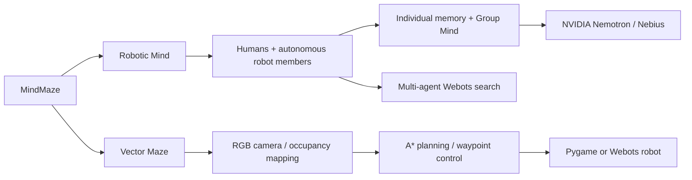

# MindMaze

### Shared intelligence. Autonomous search. Visual navigation.

Two simulation-first robotics projects in one workspace: **Robotic Mind**, a shared cognitive space for humans and autonomous robots, and **Vector Maze**, a vision-driven maze navigation system. Each project has its own code, dependencies, tests, and launch commands.


> All robotic scene images below are genuine captures of the running Webots simulation. UI images show the working application with authenticated NVIDIA Nemotron orchestration. Physical robot hardware has not been deployed.

## Choose a project

| Project | What it demonstrates | Start here |
|---|---|---|
| **Robotic Mind** | Four autonomous scouts, their own cameras, persistent individual/shared memory, a live neural knowledge graph, and NVIDIA Nemotron coordination through Nebius Token Factory | [Overview and setup](robotic-mind/README.md) |
| **Vector Maze** | RGB camera → occupancy map → A* path planning → waypoint control, with Pygame demos and Webots integration | [Overview and setup](vector-maze/README.md) |

The projects are normal folders in this repository, not Git submodules. They run independently. Open **[MindMaze.code-workspace](MindMaze.code-workspace)** in VS Code to see both projects together.

## Robotic Mind: a team that learns together

Give the team a mission:

> **Find all red objects. Split up and avoid searching the same places twice.**

NVIDIA Nemotron interprets the command and assigns regions to capable robots. Each scout executes a deterministic sweep and detects red parcels using its own camera. Observations become individual memories; verified discoveries enter Group Mind with provenance and spatial deduplication. Nemotron then summarizes the persisted results.

**Verified live result: 3 unique red objects · 4/4 sectors cleared · 4 scouts · 100% planned coverage.** Strict Nebius mode was used, with no mock fallback. [Inference evidence](robotic-mind/docs/NEBIUS_VALIDATION.json).

### Mission control


Live robot telemetry, camera feeds, assignments, mission stages, an activity timeline, and inspectable Active Mind/Deep Mind state share one dashboard.

### The collective as a neural graph


Each neuron represents an agent, mission, observation, memory, discovery, or mapped region. Connections trace stored evidence: who observed an object, what became memory, and what knowledge was shared. New evidence activates the network as the robots work. Search, filters, zoom, pan, and a neuron inspector make the relationships explorable.


### The simulation, from every angle

| Top-down layout | Scout close-up |
|---|---|
|  |  |


The warehouse is 16 × 16 m with colored parcels, obstacles, four search regions, and four independently controlled aerial scouts. Flight is simplified kinematic motion. Camera perception uses OpenCV; inference handles mission-level decisions rather than low-level movement.

### Run Robotic Mind

Requires Windows, Python 3.11+, Node.js, and Webots R2025a. From the cloned MindMaze folder:

```powershell
cd robotic-mind
python -m venv .venv
.\.venv\Scripts\python.exe -m pip install -e ".[dev]"
Copy-Item .env.example .env
cd frontend
npm.cmd ci
cd ..
powershell.exe -NoProfile -ExecutionPolicy Bypass -File scripts/start_demo.ps1
```

The default example configuration uses an explicitly labeled development mock. To use the verified NVIDIA path, configure your **local** `.env`:

```dotenv
LLM_MODE=nebius
STRICT_HACKATHON_MODE=true
NEBIUS_API_KEY=your-local-key
NEBIUS_BASE_URL=https://api.tokenfactory.nebius.com/v1
NEBIUS_MODEL=nvidia/nemotron-3-super-120b-a12b
```

Open **http://localhost:5173** for mission control, **http://localhost:5173/?view=group** for the neural graph, and **http://localhost:8000/docs** for API documentation. Webots opens as a separate desktop application.

See [the complete build report](robotic-mind/docs/BUILD_REPORT.md) and [the protocol reference](robotic-mind/docs/PROTOCOL.md) for architecture, persistence, SDK, schemas, and limitations. The Python suite has **39 passing tests**; frontend lint/typecheck/build and browser interactions were validated.

## Vector Maze: navigation from visual evidence

Vector Maze explores a different part of the robotics stack: recover free/occupied space from an overhead camera, plan a route, and execute it through a replaceable robot adapter. It includes camera-to-grid mapping, A* search, footprint-aware collision checks, waypoint control, Pygame visualization, and a Webots Vector-style robot.

It is a separate navigation prototype, not a hidden dependency of Robotic Mind. Its cameras, coordinate conventions, setup, and test commands are documented in [its own README](vector-maze/README.md).


The captured run reached its goal in 1,292 simulation steps with **zero collisions**. The standard test suite passed **124 tests**; **6 opt-in Webots integration tests** were skipped in this validation run.

```powershell
cd vector-maze
python -m venv .venv
.\.venv\Scripts\python.exe -m pip install -e ".[dev]"
.\.venv\Scripts\python.exe scripts/run_simulation.py
```

See the project README for perception and Webots launch options.

## Repository layout

```text
MindMaze/
├── README.md
├── MindMaze.code-workspace
├── robotic-mind/
│   ├── src/robotic_mind/        Platform, minds, missions, API, persistence, LLM
│   ├── src/robotic_mind_sdk/    Reusable RobotClient and RobotAdapter
│   ├── frontend/              React + TypeScript mission control
│   ├── simulation/webots/     Warehouse, scouts, own-camera perception
│   ├── scripts/               Launch, seed, acceptance, screenshots
│   ├── tests/
│   └── docs/images/           Actual simulation and UI captures
└── vector-maze/
    ├── src/vector_maze/        Mapping, planning, control, robot adapters
    ├── webots/                Vector-style robot, maze, controllers
    ├── scripts/               Simulation and perception demos
    ├── configs/
    └── tests/
```



## Capture the demo again

With Robotic Mind running, use its documentation tools from `robotic-mind/`:

```powershell
.\.venv\Scripts\python.exe scripts/capture_setup.py
.\.venv\Scripts\python.exe scripts/capture_showcase.py
```

The first exports actual Webots views. Hide camera overlays in Webots first using **Overlays → Hide All Camera Overlays**. The second submits a live mission and captures the UI. Images are saved to `robotic-mind/docs/images/` for the README.

The repository excludes local `.env` files, API credentials, SQLite databases, Python environments, npm dependencies, logs, build output, and simulator runtime settings.
