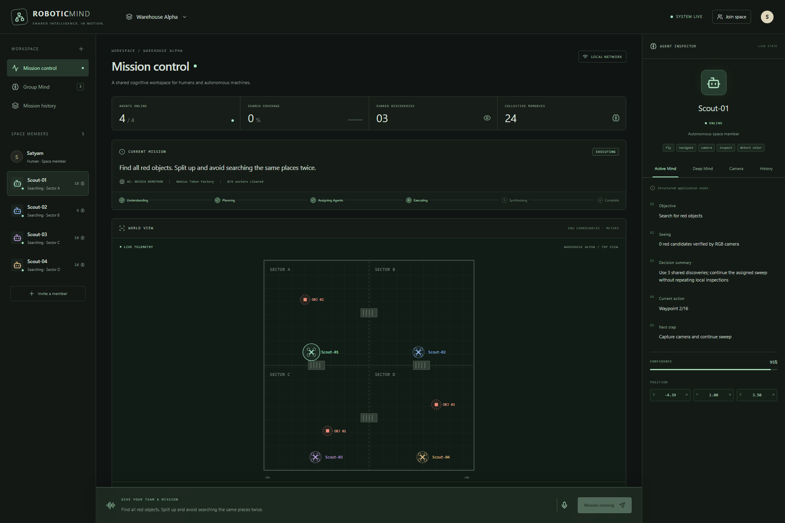
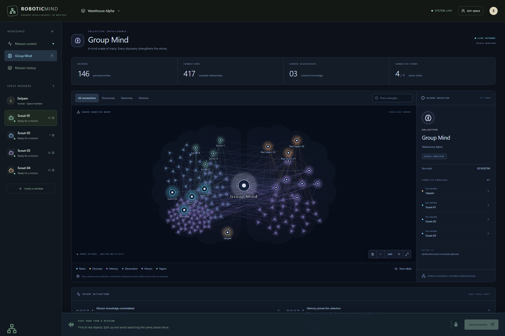
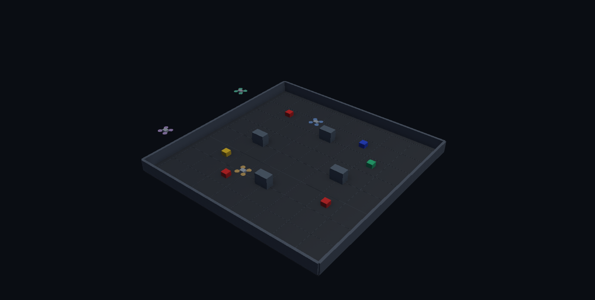
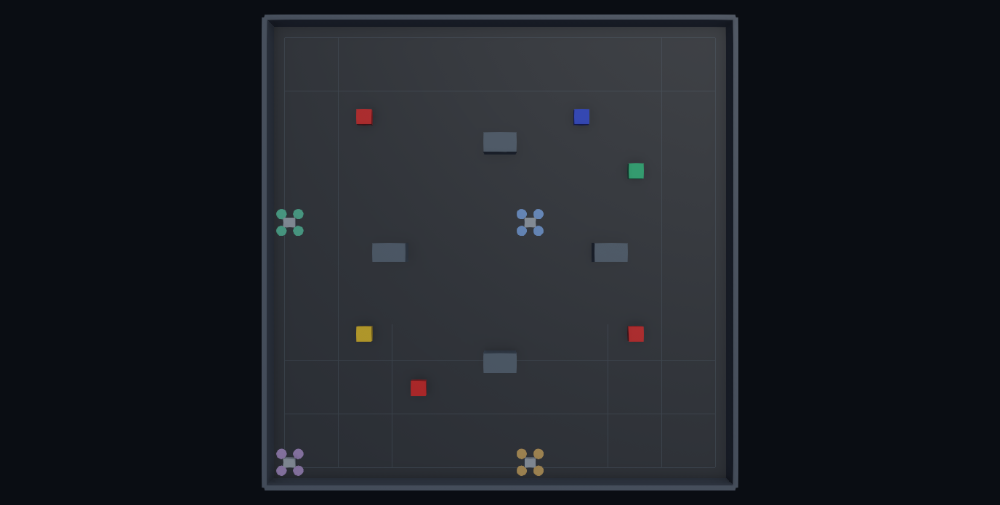
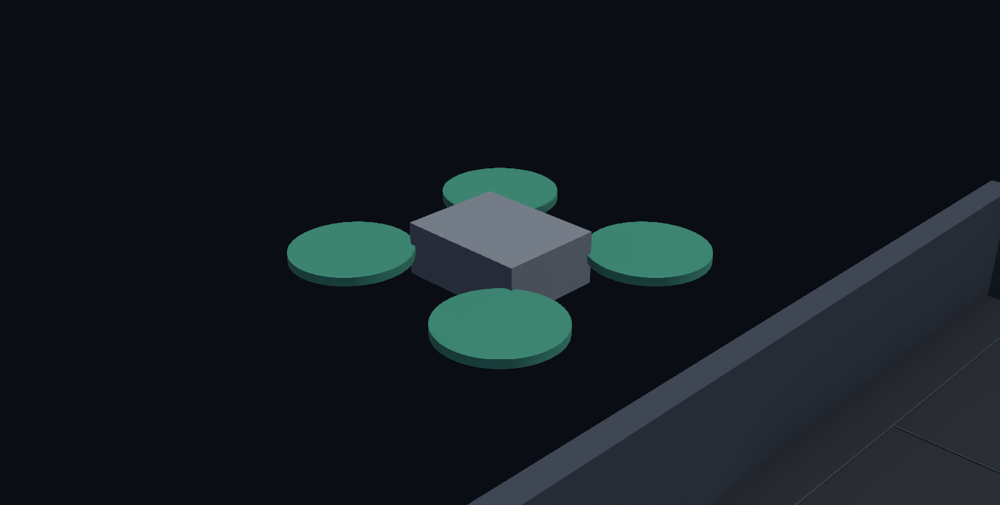
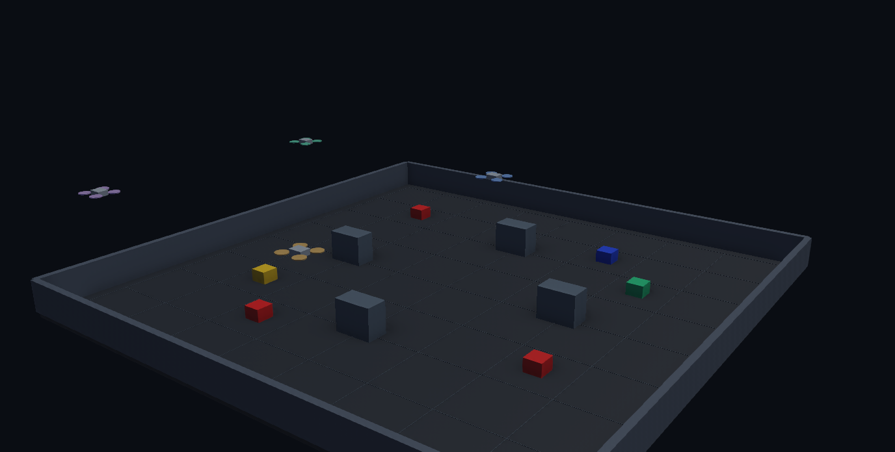
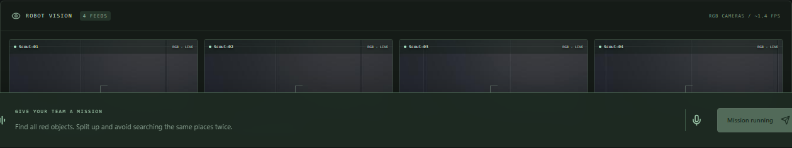
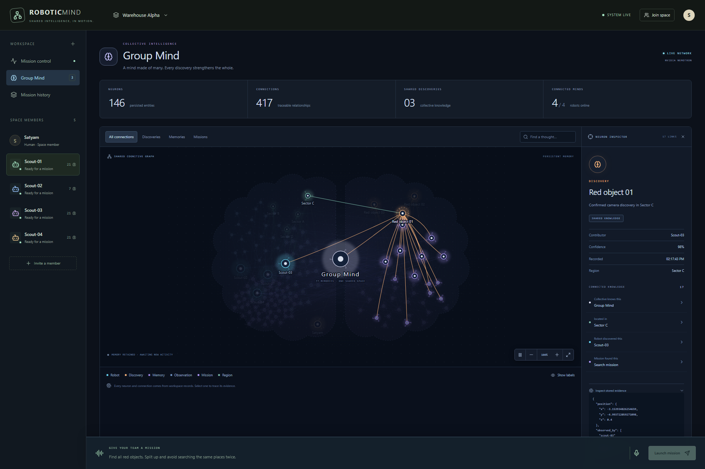
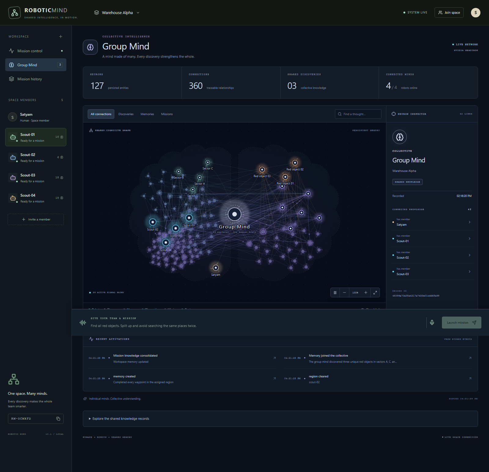
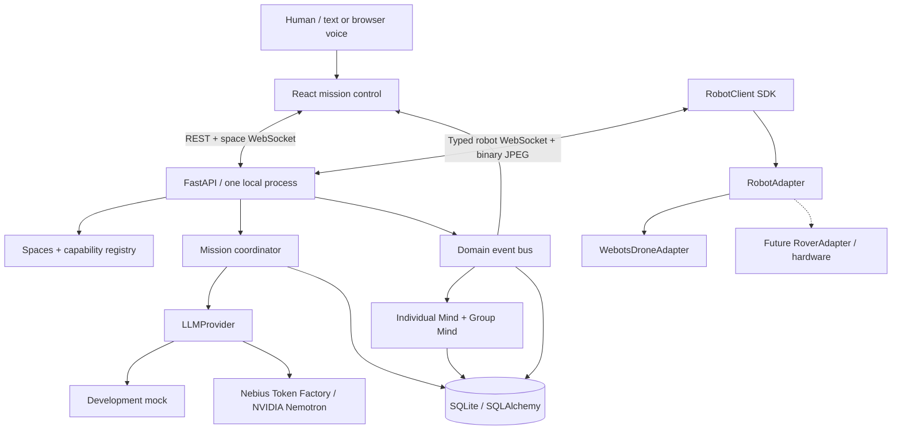

# Robotic Mind

**A shared cognitive workspace for humans and autonomous machines.**

One person. Four autonomous scouts. One persistent space. When one machine discovers something, the entire team can use that knowledge.

Robots usually operate as isolated tools: their observations disappear into individual logs, and the next robot has to learn the same thing again. Robotic Mind makes robots first-class members of a collaborative space, with identities, capabilities, current cognitive state, durable memory, and shared knowledge with provenance.

This is a new, independent repository. It does not import or require `vector-maze` or unrelated product code.

## What works

- Create/join spaces with random readable invites; humans and robots appear in one membership list.
- Register arbitrary robot manifests through a reusable Python SDK and typed WebSocket handshake.
- Persist individual observations, Deep Mind, shared discoveries, region outcomes, mission results, and events in SQLite.
- Inspect explicit Active Mind state, memory growth, live JPEG cameras, telemetry, assignments, and shared knowledge in a responsive React dashboard.
- Run a new Warehouse Alpha Webots world with four independently controlled aerial agents, their own downward RGB cameras, and deterministic waypoint sweeps.
- Detect red parcels using camera pixels and OpenCV; estimate their world positions and spatially merge corroborating observations.
- Interpret, coordinate, and synthesize missions through interchangeable mock/Nebius providers with validated outputs and visible failures.

**Verified:** the real Webots/SDK/camera vertical slice completes in both development mock mode and **strict Nebius/NVIDIA Nemotron mode** with **3 unique red objects, 4/4 sectors cleared, 100% coverage**. Authenticated mission understanding, multi-agent planning, and final synthesis all succeeded. See [recorded inference evidence](docs/NEBIUS_VALIDATION.json).




The dashboard is a lightweight telemetry map. The separate Webots desktop application provides the full 3D simulation.

## The robotic setup

These images were captured from the running Webots scene and application. The hardware shown is simulated; the mission, camera processing, memory, and authenticated Nemotron calls are live.



| Warehouse from above | Scout camera platform |
|---|---|
|  |  |





Reproduce these with `python scripts/capture_setup.py` while Webots is running, and `python scripts/capture_showcase.py` for UI screenshots during a real mission. Hide camera overlays using **Overlays → Hide All Camera Overlays** before scene capture. Scene capture only changes the documentation viewpoint; it never supplies object locations to perception.

## Neural Group Mind

Open **http://localhost:5173/?view=group** to explore the collective as a neural graph. Robots, humans, missions, assignments, observations, memories, discoveries, and mapped regions become real selectable neurons. Their connections come from stored provenance: observed, remembers, shares, discovered, confirmed, assigned, and cleared. Private evidence remains distinguishable from shared knowledge.

New evidence pulses as it arrives; signals follow recent evidence paths and active assignments. Idle memory stays visible. Search, category filters, zoom, pan, keyboard selection, label controls, and animation pause make the graph explorable. Select a neuron to inspect its contributor, confidence, related records, and stored evidence. Shared records remain available below the visualization.

The backend projects this view from SQLite plus configured world regions at `/api/spaces/{id}/mind/graph`; the browser refreshes it every two seconds. It adds no invented semantic connections or hidden model reasoning. Graphs above 450 nodes show an explicit truncation notice. A live strict Nemotron mission grew the network from **108 to 127 neurons** and **303 to 360 connections**, while retaining the three unique red discoveries.



## Architecture



`RobotAgent` wraps a manifest and generic capability checks. No mission code branches on `agent_type == "drone"`. The coordinator requires `navigate`, `camera`, and `detect_color`. Simulator control is isolated from the backend and SDK.

**Active Mind** is structured application state: objective, observation summary, decision summary, current action, next step, assignment, confidence, status, position, and timestamp. It is not model chain-of-thought. It is transient; meaningful changes create durable timeline events.

**Deep Mind** stores typed memory entries with ownership, category, title, summary, tags, structured evidence, importance, mission reference, sharing flag, and timestamp. Robot counters come from stored records.

**Group Mind** combines persistent shared memories, discoveries with first discoverer and corroborating observers, cleared sectors, assignments, and results. Robots receive current shared discoveries on connection and live discovery/clearance events afterward. Planning uses existing Group Mind context.

## Setup on Windows

Requires Python 3.11+ (tested with 3.12.10), Node.js (tested with 24.15.0), and Webots R2025a. Run commands from the new repository:

```powershell
cd C:\Users\newuser3714\OneDrive\Desktop\hacakathon\robotic-mind
python -m venv .venv
.\.venv\Scripts\python.exe -m pip install -e ".[dev]"
Copy-Item .env.example .env
cd frontend
npm.cmd ci
cd ..
```

An exact Python environment snapshot is in `requirements.lock.txt`; use `pip install -r requirements.lock.txt` followed by `pip install -e . --no-deps` to reproduce it. The frontend dependency graph is locked by `frontend/package-lock.json`.

`npm.cmd` works even when PowerShell blocks the installed `npm.ps1` wrapper. Activation of the Python environment is unnecessary when using the explicit interpreter path.

### One command

```powershell
powershell.exe -NoProfile -ExecutionPolicy Bypass -File scripts/start_demo.ps1
```

Open **http://localhost:5173**. Backend docs: **http://localhost:8000/docs**.

The launcher starts the backend, waits for readiness, idempotently creates/reuses Warehouse Alpha, starts Vite, and launches Webots with the generated invite. The scouts register themselves; seed code never inserts robots. Closing Webots stops the launcher-owned backend/frontend process trees. Logs are in `artifacts/`. Keep ports 8000 and 5173 free before launching. The script's process-scoped execution-policy option does not change your machine's persistent policy.

### Three terminals

Backend:

```powershell
.\.venv\Scripts\python.exe scripts/start_backend.py
```

Frontend:

```powershell
cd frontend
npm.cmd run dev
```

Seed the space, then supply its printed invite to Webots:

```powershell
.\.venv\Scripts\python.exe scripts/seed_demo.py
.\.venv\Scripts\python.exe scripts/launch_webots.py --invite RM-XXXXXX
```

`RM-XXXXXX` is a placeholder; use your generated invite. Webots is discovered in Program Files or `%LOCALAPPDATA%/Programs/Webots`, or through `WEBOTS_HOME`. The launcher writes a machine-local ignored `runtime.ini` with this repository's Python interpreter.

Useful VS Code tasks: **Start Backend**, **Start Frontend**, **Launch Webots**, **Run Tests**, and **Start Robotic Mind Demo**.

## Nebius / Nemotron

Default development mode is explicit and deterministic:

```dotenv
LLM_MODE=mock
STRICT_HACKATHON_MODE=false
```

For the hackathon recording, edit your ignored `.env` locally and restart the backend:

```dotenv
LLM_MODE=nebius
STRICT_HACKATHON_MODE=true
NEBIUS_API_KEY=your-key-here
NEBIUS_BASE_URL=https://api.tokenfactory.nebius.com/v1
NEBIUS_MODEL=nvidia/nemotron-3-super-120b-a12b
```

The exact configured and live-verified model is **`nvidia/nemotron-3-super-120b-a12b`**. Earlier development runs used **`deterministic-mock`**. The authenticated strict-mode run completed all three orchestration calls on the first attempt. Strict mode refuses mock configuration and missing credentials. Nebius failures never fall back to mock. The browser sees public provider/model metadata; request timings are recorded in domain events. Credentials and model reasoning are never exposed.

Three meaningful model operations drive the mission: command → `MissionSpec`, manifests/positions/regions/shared context → validated `MissionPlan`, and persisted Group Mind facts → `MissionResult`. Invalid JSON/schema output is retried once at the application level; transport retries are bounded separately. Numeric synthesis facts are checked against persistence before success. Models never control rotors or navigation ticks.

The OpenAI Python SDK is used only as an OpenAI-compatible HTTP client for Nebius. Official [Nebius example](https://github.com/nebius/token-factory-cookbook/blob/main/models/nemotron/nemotron3-super-120B.md) documents the same model ID and also shows the regional base URL `https://api.tokenfactory.us-central1.nebius.com/v1/`; override the configurable endpoint if your account requires it. The default endpoint above was verified with an authenticated end-to-end run on October 28, 2026.

## Demo sequence

1. Launch the demo and verify four scouts show **ONLINE**.
2. Enter: **Find all red objects. Split up and avoid searching the same places twice.**
3. Watch understanding, planning, assignment, execution, synthesis, and completion.
4. Watch the Webots scouts move simultaneously through separate sectors. Inspect their own cameras in the dashboard.
5. Click a scout; inspect Active Mind and accumulating Deep Mind entries.
6. Open Group Mind; inspect each discovery's position, confidence, discoverer, and confirming observers.
7. Verify **3 unique objects · 4 sectors · 100% coverage**. The default non-overlapping layout need not produce a cross-robot duplicate; spatial merging and corroborating provenance are independently tested.
8. Repeat the mission to demonstrate persistent shared knowledge. Discoveries remain unique while mission observations and memories accumulate.

Voice input uses browser `SpeechRecognition`/`webkitSpeechRecognition` when available. Transcription fills the command input for review; it never auto-submits. Unsupported browsers retain fully functional text input. Voice microphone permissions/network availability depend on the browser and were not tested with live audio.

## Simulation and perception

Warehouse Alpha is 16 × 16 m in ENU coordinates (`x` east, `y` north, `z` up), split into four regions loaded from a generic world model. Four 16-point serpentine sweeps run at 3.5 m altitude and a maximum 2.4 m/s. A simplified rigid visual quadrotor uses continuous self-pose updates, not rotor physics or teleportation between waypoints. Shelves are below flight altitude; this is not obstacle avoidance or SLAM.

Three red parcels and three blue/yellow/green distractors live only in the world generator. Controllers do not query their locations. Every robot reads its own 320 × 240 camera, segments two HSV red hue intervals, rejects tiny/edge-clipped candidates, and projects the centroid onto an assumed parcel-top plane using pose, FOV, camera offset, and yaw. See the official [Webots camera reference](https://github.com/cyberbotics/webots/blob/R2025a/docs/reference/camera.md) for BGRA image format and horizontal FOV semantics.

`simulation/webots/config/sensors.json` supplies per-scout brightness, blur, noise, color shift, horizontal FOV, and yaw. Environment variables `CAMERA_BRIGHTNESS`, `CAMERA_BLUR`, `CAMERA_NOISE`, and `CAMERA_COLOR_SHIFT` override image transformations. Restart Webots after changes. Default transformations are conservative. Large color/geometry changes can invalidate the simple detector or sweep coverage assumptions.

Each local target is reported once per region sweep. Confirmed observations (`confidence >= 0.7`) enter Group Mind. Same label + XY distance within the configurable 0.8 m radius merges evidence, preserves the first discoverer, adds observers, and retains the maximum observed confidence. This confidence is a segmentation heuristic, not a calibrated probability. World coordinates are approximate, not ground-truth localization.

Cameras travel as bounded binary JPEG frames on the robot connection. The backend retains the latest frame in memory; the browser fetches it around 1.4 FPS. JSON WebSockets carry state/events, never raw video. Camera frames and telemetry are transient. SQLite is not written every simulation tick.

## Robot SDK

```python
from robotic_mind_sdk import AgentManifest, RobotClient
from robotic_mind_sdk.models import MemoryEntry, Telemetry

manifest = AgentManifest(
    agent_id="rover-05",
    display_name="Rover 05",
    agent_type="rover",
    capabilities=["navigate", "camera", "detect_color"],
    sensors=["rgb_camera", "position"],
    actions=["move_to", "scan"],
)
robot = RobotClient("Rover 05", "RM-XXXXXX", manifest, server_url="http://localhost:8000").connect()
robot.connected.wait(5)
robot.publish_telemetry(Telemetry(position={"x": 0, "y": 0, "z": 0}))
robot.remember(MemoryEntry(title="Connected to shared workspace"))
assignment = robot.next_assignment()
# Execute with your adapter, then report started/progress/completed.
robot.close()
```

The SDK also exposes `publish_observation`, `update_active_mind`, `publish_shared_memory`, `publish_camera`, `task_status`, and the live `group_mind` cache. Its background transport joins, heartbeats, handles assignments/knowledge updates, and reconnects. Future hardware supplies a `RobotAdapter` implementing `get_pose`, `move_to`, `stop`, `capture_camera`, and `capabilities`. The SDK package has no Webots import.

A fifth agent can join without backend edits. The planner can allocate multiple regions per agent; having more agents than regions does not fabricate extra tasks. This demo's floor sweeps and projection are designed for aerial cameras; a physical rover needs a suitable world route and camera projection implementation in its adapter/controller.

## Validation

```powershell
.\.venv\Scripts\python.exe -m pytest -q
.\.venv\Scripts\ruff.exe check .
.\.venv\Scripts\ruff.exe format --check .
cd frontend
npm.cmd run lint
npm.cmd run typecheck
npm.cmd run build
cd ..
```

Ordinary tests need no Webots GUI. They cover spaces/invites, registration/manifest validation, capabilities, heartbeats, state and memory, persistence, observations/deduplication/provenance/confidence, mission transitions and failure, plan parsing/validation, mock/Nebius configuration and retries, event subscriptions, browser WebSocket events, SDK wire messages, an actual SDK TCP connection, and camera perception.

The suite also verifies neural graph provenance, private/shared boundaries, space isolation, bounded output, and the graph API. Run `python scripts/check_neural_browser.py` for neural controls/mobile checks and `python scripts/check_neural_growth.py` to submit a real mission and verify visible graph growth.

For real Webots acceptance, with all services running:

```powershell
.\.venv\Scripts\python.exe scripts/check_demo.py
```

This submits a real mission, waits for four online robots, and asserts the final count/coverage. It saves `artifacts/demo-acceptance.json` and four actual camera frames. It labels mock versus real inference explicitly.

For the running browser UI:

```powershell
.\.venv\Scripts\python.exe -m playwright install chromium
.\.venv\Scripts\python.exe scripts/check_browser.py
```

Review [the build report](docs/BUILD_REPORT.md) and [the API/protocol reference](docs/PROTOCOL.md) for complete schemas, results, endpoint list, repository tree, limitations, and follow-up work.
