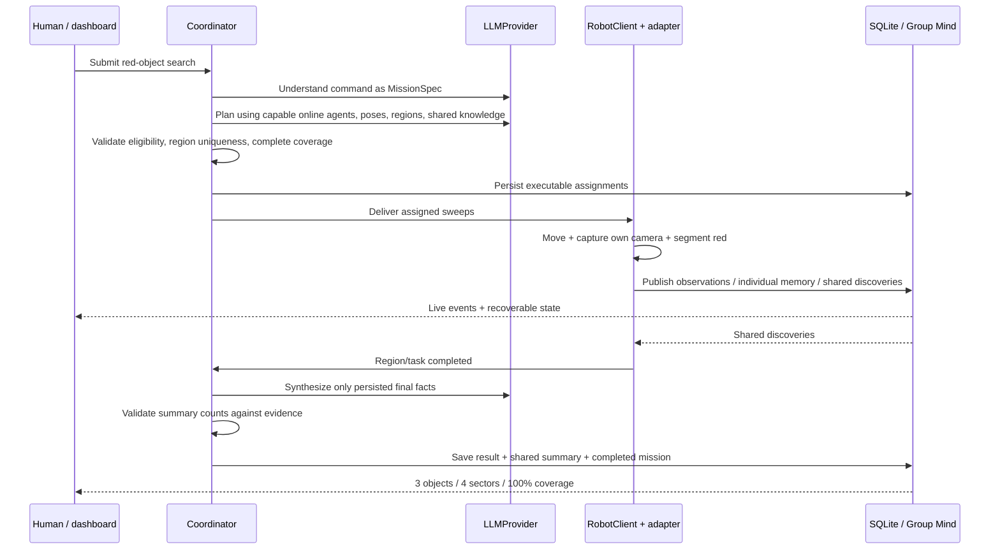

# Robotic Mind — build and acceptance report

Date: October 28, 2026. New repository: `C:\Users\newuser3714\OneDrive\Desktop\hacakathon\robotic-mind`. Git initialized locally. `vector-maze` was inspected for installation/launch conventions and was not modified. No unrelated product code was copied.

**Live NVIDIA acceptance passed:** authenticated strict-mode Nemotron mission completed on October 28, 2026 at 4:11 p.m. Pacific: three unique red objects, four sectors cleared, four participating scouts, 100% coverage. Understanding took 2.603 s, planning 3.202 s, and synthesis 2.571 s, all on the first attempt. See [credential-free validation evidence](NEBIUS_VALIDATION.json).

## 1. Final repository tree

```text
robotic-mind/
├── .git/                         independent local repository
├── .vscode/                      tasks, interpreter/testing settings, debugger
├── .env.example                  safe configuration template
├── .gitignore
├── pyproject.toml
├── requirements.lock.txt         tested Python environment
├── README.md
├── src/
│   ├── robotic_mind/
│   │   ├── config.py             validated settings; strict inference mode
│   │   ├── platform.py           spaces, membership, robot message dispatch
│   │   ├── world.py              generic sectors and search waypoints
│   │   ├── perception.py         image transforms, red segmentation, projection
│   │   ├── domain/models.py      typed manifests, agent/mind/mission/wire models
│   │   ├── agents/registry.py    capability checks and heartbeat classification
│   │   ├── api/app.py            REST, OpenAPI, browser/robot WebSockets
│   │   ├── events/bus.py         scoped events, persistence, subscriptions
│   │   ├── minds/service.py      individual memory, sharing, deduplication
│   │   ├── missions/
│   │   │   ├── coordinator.py    plan validation
│   │   │   └── service.py        planning, assignment, completion, synthesis
│   │   ├── llm/
│   │   │   ├── base.py           LLMProvider abstraction
│   │   │   ├── mock.py           explicit deterministic development provider
│   │   │   └── nebius.py         OpenAI-compatible Nemotron provider
│   │   └── persistence/database.py
│   └── robotic_mind_sdk/
│       ├── adapter.py            generic hardware contract
│       ├── client.py             background transport + public SDK API
│       └── models.py             wire-model exports
├── frontend/
│   ├── package.json / package-lock.json
│   ├── vite.config.ts / tsconfig.json / eslint.config.js
│   ├── index.html
│   └── src/
│       ├── main.tsx / App.tsx
│       ├── api.ts / types.ts
│       └── style.css
├── simulation/webots/
│   ├── worlds/warehouse_alpha.wbt
│   ├── config/sensors.json
│   └── controllers/scout_controller/scout_controller.py
├── scripts/
│   ├── start_backend.py / start_demo.ps1
│   ├── seed_demo.py / generate_world.py / launch_webots.py
│   └── check_demo.py / check_browser.py
├── tests/
│   ├── test_platform.py
│   ├── test_reliability.py
│   ├── test_sdk.py
│   └── test_sdk_live.py
├── docs/
│   ├── PROTOCOL.md / BUILD_REPORT.md
│   └── images/                   captured desktop, mobile, Group Mind
└── artifacts/                    ignored local reports, frames, logs
```

Package `__init__.py` files and generated environments/build output are omitted above. All listed Python modules implement working behavior; there are no empty scaffold services.

## 2. Architecture summary

Single FastAPI process, single SQLite database, Vite/React frontend, and native Webots. Domain models are simulator-independent. `RobotAgent` and `AgentManifest` support capability-based eligibility. `RobotClient` communicates over a public typed robot protocol. `RobotAdapter` separates physical/simulator control. Individual and Group Mind interact through observation events. `LLMProvider` separates model orchestration from deterministic flight.

The Group Mind now has an interactive neural visualization backed by a typed graph API. `src/robotic_mind/minds/graph.py` builds provenance nodes/edges from real records; `frontend/src/neural/` provides layout, rendering, selection, filters, search, zoom/pan, and evidence inspection. `tests/test_mind_graph.py` tests space isolation, private/shared provenance, graph limits, and the HTTP contract. `scripts/check_neural_browser.py` and `scripts/check_neural_growth.py` verify the controls and real-time growth. A strict Nemotron mission increased the visible graph from 108/303 nodes/edges to 127/360, with zero browser runtime errors and three unique objects at full coverage. Screenshot: `docs/images/neural-mind.png`.

## 3. Database schema

`records(id PRIMARY KEY, kind INDEX, space_id INDEX, owner_id INDEX, data JSON)` stores spaces, members with manifests, missions with results, assignments, observations, memories, discoveries, and cleared regions. `events(sequence INTEGER PRIMARY KEY, space_id INDEX, data JSON)` stores important domain history. SQLite uses WAL and bounded busy waits. Ownership/kind collisions are rejected. Memory survives restart; telemetry, Active Mind, sockets, and latest camera images are ephemeral. The full DDL and consistency limitations are in [PROTOCOL.md](PROTOCOL.md#database-schema).

## 4–5. API endpoints and WebSocket protocol

See the complete [HTTP endpoint table](PROTOCOL.md#http-endpoints), [browser protocol](PROTOCOL.md#browser-websocket), and [robot protocol](PROTOCOL.md#robot-websocket). FastAPI also generates `/docs` and `/openapi.json`.

Browser: `/ws/spaces/{space_id}`, initial recoverable snapshot followed by scoped events. Robot: `/ws/robots/{agent_id}`, invite/manifest handshake, heartbeat, telemetry, mind/memory/observation updates, task status, binary JPEG uploads, assignment and shared-knowledge delivery. The SDK reconnects automatically; identities cannot be claimed concurrently or reassigned across spaces.

## 6. Robot SDK API

`RobotClient(name, invite_code, manifest, server_url)`: `connect`, `publish_telemetry`, `publish_observation`, `update_active_mind`, `remember`, `publish_shared_memory`, `publish_camera`, `task_status`, `next_assignment`, `close`. `connected` indicates readiness; `group_mind` caches discoveries and cleared regions; `errors` captures protocol errors. `RobotAdapter`: `get_pose`, `move_to`, `stop`, `capture_camera`, `capabilities`. There are no Webots imports in the SDK.

## 7–9. Active Mind, Deep Mind, and Group Mind

Active Mind: `status`, `objective`, `assignment`, `observation_summary`, `decision_summary`, `current_action`, `next_step`, `confidence`, `position`, `updated_at`. These are explicit controller-generated summaries, not chain-of-thought.

Deep Mind: `id`, `owner_type`, `owner_id`, `space_id`, `category`, `title`, `summary`, `tags`, `structured_data`, `importance`, `created_at`, `mission_id`, `shared`. Observation and task-outcome evidence remains available after disconnect/restart.

Group Mind stores selected memories, unique objects, first discoverer, corroborating observers, confidence, observation count, contributing mission references, cleared regions, and final summaries. Current missions/assignments join the same space snapshot. Group knowledge is delivered to robots and model planning. UI counters derive from persisted entries.

## 10–12. Simulation, world, and controller

Webots R2025a on this Windows laptop, discovered under `%LOCALAPPDATA%/Programs/Webots`. A generated 16 × 16 m Warehouse Alpha contains boundary walls, grid floor, four shelves, three red parcels, three distractor parcels, four spawn points, and distinct scout accents. Regions A–D each have a 16-point serpentine sweep. The simulator uses ENU coordinates with flight at 3.5 m.

Each scout has its own controller process, SDK connection, camera, mission queue, and waypoint state. Movement is continuous at up to 2.4 m/s, with observation dwell at waypoints. Kinematic self-pose updates simplify aerial physics. The backend never imports Webots. Controllers access only their own pose/camera for perception; known parcel positions are not fed to detectors.

## 13–14. Camera pipeline and deduplication

Own BGRA image → BGR image → configurable brightness/blur/noise/color transform → HSV red intervals → morphology/contours → size/edge checks → approximate pinhole world projection with camera offset/FOV/yaw → typed observation → individual memory → confidence-gated Group Mind → events/other robots/browser.

Images are 320 × 240. JPEG frames travel as binary messages and are fetched by the browser around 1.4 FPS. Discoveries with the same semantic label within 0.8 m in XY merge, preserve first discoverer, union observers, and retain maximum confidence. Low-confidence observations remain private memory. The default disjoint search yields no required duplicate; multi-observer merging is verified independently in tests. Perception confidence is a heuristic; projection assumes known parcel-top height.

## 15–17. Nemotron and Nebius configuration

Configured target: **`nvidia/nemotron-3-super-120b-a12b`**. Configurable base URL default: **`https://api.tokenfactory.nebius.com/v1`**. Provider: **Nebius Token Factory**, through `AsyncOpenAI`. The key stays in ignored local environment configuration. See the [official Nebius model example](https://github.com/nebius/token-factory-cookbook/blob/main/models/nemotron/nemotron3-super-120B.md) for the corresponding model and an alternative regional endpoint.

Actual latest verified inference mode: **nebius**, model **`nvidia/nemotron-3-super-120b-a12b`**, with **`STRICT_HACKATHON_MODE=true`**. A standalone key/model probe succeeded, followed by authenticated understanding, planning, and synthesis in the full four-scout Webots mission. Earlier runs used `deterministic-mock`. Unit tests verify configuration, strict-mode rejection, bounded retries, parsing/validation, and failure propagation. Strict mode cannot fall back to mock. Provider/model/purpose/timing/timestamp are persisted in LLM-completion events. Reasoning content is never persisted or sent to the browser.

## 18. Mission orchestration



One active mission per space. No completion until all assignments report completion. Invalid plans, task failure, inference failure, or restart produce visible failure. Robot disconnect leaves an incomplete assignment and an unavailable member; automatic reassignment is intentionally absent.

## 19–21. Test and quality results

| Check | Result |
|---|---|
| `python -m pytest -q` | **39 passed**; one dependency deprecation warning |
| `ruff check .` | Passed |
| `ruff format --check .` | Passed after formatting code and Python README examples |
| `npm.cmd run lint` | Passed, zero lint warnings |
| `npm.cmd run typecheck` | Passed |
| `npm.cmd run build` | Passed; TypeScript + Vite production build |
| Actual SDK TCP/WebSocket test | Passed, no GUI needed |
| Actual Webots/SDK/OpenCV mission | Passed in mock and strict Nebius modes |
| One-command PowerShell launcher | Started backend, frontend, seed, four real controllers |
| Playwright browser smoke | Passed; zero browser runtime errors; 390 px mobile has no horizontal overflow |
| Live authenticated Nebius mission | **Passed: all three Nemotron stages, first attempt** |
| Live voice microphone/transcription | **Not run**; unsupported-browser fallback exists |

The dependency warning is Starlette's deprecation of its httpx-backed TestClient; it does not cause a failure. Normal tests include real transport, persistence/restart, capability validation using a rover, event delivery, confidence handling, provenance, spatial merging, camera color detection, malformed output/configuration, and assignment validation. They do not require Webots.

The live acceptance result is saved in `artifacts/demo-acceptance.json`; real camera frames are `artifacts/scout-01.jpg` through `scout-04.jpg`. Screenshots are copied to `docs/images/`. A rerun after restarting the backend retained prior memory and still completed with three unique objects, demonstrating reuse of persistent Group Mind.

## 22–26. Exact setup and launch commands

From PowerShell:

```powershell
cd C:\Users\newuser3714\OneDrive\Desktop\hacakathon\robotic-mind
python -m venv .venv
.\.venv\Scripts\python.exe -m pip install -e ".[dev]"
Copy-Item .env.example .env
cd frontend
npm.cmd ci
cd ..
```

Backend:

```powershell
.\.venv\Scripts\python.exe scripts/start_backend.py
```

Frontend, separate terminal from repository root:

```powershell
cd frontend
npm.cmd run dev
```

Seed, then Webots in another terminal:

```powershell
.\.venv\Scripts\python.exe scripts/seed_demo.py
.\.venv\Scripts\python.exe scripts/launch_webots.py --invite RM-XXXXXX
```

Use the printed invite in place of `RM-XXXXXX`. Full demo, with both ports initially free:

```powershell
powershell.exe -NoProfile -ExecutionPolicy Bypass -File scripts/start_demo.ps1
```

Frontend: `http://localhost:5173`. Backend: `http://localhost:8000`. Interactive API: `http://localhost:8000/docs`.

## 27. Known limitations

- Strict-mode inference requires a locally configured Nebius key and account/model access; the recorded authenticated acceptance run passed.
- Kinematic drone motion; no rotor physics, collision avoidance, SLAM, battery dynamics, or physical hardware.
- Current world/perception are configured for aerial downward-camera sweeps and red-object search. A rover can join/receive missions with no platform edits, but safe physical routes and perception belong in its controller/adapter configuration.
- Coverage means all planned waypoints/regions completed, not a mathematically proven visible-area measure in arbitrary occluded worlds.
- Red segmentation, fixed parcel-plane projection, heuristic confidence, and fixed spatial radius assume this demonstration scale/lighting.
- No automatic reassignment after robot loss. Backend restarts explicitly fail interrupted missions; memory remains intact.
- Single worker; no transactional outbox, exactly-once transport, durable SDK outbox, vector retrieval, production authentication, or cloud deployment.
- Invites support local joining, not hardened access control. Keep APIs on loopback. Human online status is membership state rather than browser presence tracking.
- Latest frames/telemetry/Active Mind vanish on backend restart. Individual/shared memories, mission records, discoveries, and events persist.
- Browser speech support depends on browser and microphone service permissions. Live audio was not validated.

## 28. Demo sequence

Start the launcher, open the dashboard, confirm four online scouts, and submit: **Find all red objects. Split up and avoid searching the same places twice.** Explain explicit mock/real mode before recording. Show simultaneous movement in Webots, per-robot RGB views, Active Mind summaries, growing Deep Mind, shared facts with contributors, final result, and repeat mission with preserved discoveries. In strict real mode, show provider/model/request metadata in `/api/spaces/{id}/events` if judges want inference evidence.

## 29. Failures encountered and disposition

- Initial camera orientation was horizontal: the first run overcounted discoveries. Fixed the ENU camera rotation and pinhole transform; clean camera-based acceptance produced exactly three objects. Initial debug data was archived locally; it is excluded from Git.
- One intermediate Webots batch process exited before completing. A normal desktop run reconnected and completed its persisted assignments. Final acceptance was repeated through the actual demo launcher.
- PowerShell's `npm.ps1` wrapper was blocked by local execution policy. Commands use `npm.cmd`; no machine-wide policy was changed.
- Launcher testing exposed PowerShell handling of an API array and created a duplicate empty space. The launcher now calls the idempotent Python seed function; only that generated empty workspace was removed. The corrected launcher reused the existing invite successfully.
- Initial frontend unused-import/component-layout issues and Python formatting issues were fixed. Final lint/typecheck/build checks pass.
- A Nebius credential was unavailable during the initial build. After local configuration, the standalone probe and full strict-mode end-to-end mission both passed; no fallback was used.

## 30. Recommended next task and modularity acceptance

The private credential is now configured locally, strict mode is enabled, and `scripts/check_demo.py` passed with real Nemotron orchestration. Next, record the live mission and exercise voice input in a supported browser. Re-run the acceptance script after model, endpoint, or world changes.

Modularity checks: another capable rover uses `RobotClient` plus its own `RobotAdapter`; no spaces/memory/frontend/provider rewrite is required. Drone 05 can register with a unique manifest and invite without backend edits. Another simulator implements the adapter/controller without modifying the platform. Another model provider implements `LLMProvider.generate`. Actual execution on physical hardware was not attempted, and its navigation/perception safety is outside this local demo.
