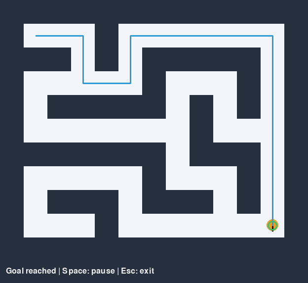

# Vector Maze

A simulation-first hackathon project for an Anki Vector robot solving a physical
maze using external vision, occupancy mapping, path planning, and motion control.
The project includes two 2D demos and Webots 3D physics navigation. Webots can
recover its navigation map from an actual overhead RGB image, while robot pose
still comes from ground truth. Physical Vector hardware is a later milestone.



## Simulation-first philosophy

Validate the navigation system in simulation before attaching hardware. Core
navigation consumes a metric `OccupancyGrid`, a `LocalizationProvider`, a
`PathPlanner`, and a `RobotController`. It never imports simulation code. Replace
the input/output adapters as hardware becomes available; keep planning and
waypoint control unchanged.

The original simulation demo uses a known JSON map and ground-truth localization.
The Phase 4 perception demo instead extracts its navigation map from synthetic
RGB frames. Only the simulator, evaluation, and debug view use the JSON map;
navigation receives the recovered map. Robot pose still uses ground-truth
localization so map extraction can be validated independently of pose error.
AprilTag localization remains a later phase.

## Architecture

```text
CameraSource -> OccupancyGridExtractor -> OccupancyGrid
GroundTruthLocalization               -> Pose2D
OccupancyGrid + LocalizationProvider
                  -> PathPlanner -> WaypointController -> RobotController

Phase 4: RGB recovered map + GroundTruthLocalization -> core -> SimulatedRobot
Later: camera perception + AprilTagLocalization -> same core -> VectorRobot
```

`MazeNavigator` plans a path and sends velocity commands. Runtime code separately
advances simulation time. A* uses four-connected moves, unit costs, and a
Manhattan heuristic. It returns the shortest endpoint-inclusive cell path, `[]`
for an unreachable goal, and raises `ValueError` for occupied/outside endpoints.

The waypoint controller turns in place before driving and caps each translation
at the remaining waypoint distance. The robot adapter caps speeds and rejects
colliding translations, stopping immediately. Collision detection measures the
distance of the entire traveled segment to every obstacle rectangle, preventing
wall tunneling even with large timesteps. The robot has a circular footprint;
planning excludes cell centers without enough clearance and validates segments.

Coordinates use meters, x right, y down, heading clockwise in radians. Cells are
`(column, row)`; storage is `cells[row][column]`. Heading zero faces right. JSON
map resolution is meters per cell. `0` is free, `1` is occupied. Bounds are
occupied; footprint contact counts as collision. The default cells are 10 cm
wide and the robot radius is 2.5 cm. These are simulation values, not calibrated
Vector dimensions. Robot integration is discrete rotate-then-translate, without
wheel dynamics, noise, or actuator latency.

## Repository

```text
src/vector_maze/
  models.py         Shared poses, cells, velocities, RGB frames
  interfaces.py     CameraSource, RobotController, LocalizationProvider, PathPlanner
  navigation.py     Hardware-independent orchestration
  simulation/       Robot, synthetic camera, navigation and comparison displays
  mapping/          Occupancy grid and footprint checks
  localization/     Ground-truth adapter
  planning/         A*
  control/          Waypoint tracking
  robot/            Extension location for physical robot adapters
  perception/       RGB-to-map extraction and evaluation metrics
  vision/           Pixel/grid/world calibration; future AprilTag processing
  utils/            Geometry
configs/            Demo configuration
assets/mazes/       JSON maze
tests/              Unit and complete navigation tests
scripts/            Runnable demo
notebooks/          Reserved for experiments
.vscode/            Interpreter, test discovery, debugger configurations
```

## Windows / VS Code setup

Use Python 3.11 or later (tested here with Python 3.12). Open the `vector-maze`
folder in VS Code and run these PowerShell commands:

```powershell
py -3.12 -m venv .venv
.\.venv\Scripts\python.exe -m pip install -r requirements.txt
.\.venv\Scripts\python.exe scripts/run_simulation.py
```

Using the virtual environment's Python directly avoids PowerShell activation
policy issues. Optional activation is `.\.venv\Scripts\Activate.ps1`. In VS Code,
select `.venv\Scripts\python.exe` with **Python: Select Interpreter** and use the
**Maze simulation** debug configuration. The standard Python extension provides
debugging and pytest discovery.

Runtime dependencies are pygame, NumPy, and OpenCV; pytest and Ruff are development dependencies.
`pyproject.toml` defines dependency ranges and `requirements.txt` installs the
editable project with development tools. No CUDA configuration is needed.

## Run and customize

The window shows walls, robot orientation, goal, and the planned path. Press
Space to pause/resume or Esc to exit. It stays open after reaching the goal so
you can inspect the result; `--exit-on-goal` closes automatically.

```powershell
.\.venv\Scripts\python.exe scripts/run_simulation.py --headless
.\.venv\Scripts\python.exe scripts/run_simulation.py --exit-on-goal
.\.venv\Scripts\python.exe scripts/run_simulation.py --config configs/demo.json
.\.venv\Scripts\python.exe scripts/run_simulation.py --headless --max-steps 20000
.\.venv\Scripts\python.exe -m pytest -q
.\.venv\Scripts\python.exe -m ruff check .
.\.venv\Scripts\python.exe -m ruff format --check .
```

Edit `configs/demo.json` to change start/goal cells, radius, speed, fixed timestep,
or display scale. Maze paths resolve relative to the config file. Edit
`assets/mazes/simple.json` to change the grid; all rows must have equal length.
Navigation completion, path length, and collisions use logging. Headless runs
exit with code 0 on success and 1 on failure or exhausted step budget. Interactive
user exit returns 0. The fixed timestep makes headless runs deterministic; the
interactive window paces at approximately `1/dt` frames per second.

To save a rendered result, pass `--screenshot artifacts/demo.png --exit-on-goal`.
For rendering checks without a window, set `$env:SDL_VIDEODRIVER = 'dummy'` before
running the rendered demo and remove it with `Remove-Item Env:SDL_VIDEODRIVER`
afterward.

Tests cover A* optimality against independent BFS, unreachable/invalid goals,
grid boundaries, corner and swept collisions, valid movement, velocity limits,
adapter substitution, RGB frame contracts, and an entire zero-collision maze run.

## Phase 4: camera-derived map navigation

Run these commands in the VS Code PowerShell terminal from `vector-maze`:

```powershell
.\.venv\Scripts\python.exe -m pip install -r requirements.txt
.\.venv\Scripts\python.exe scripts/run_perception_demo.py
.\.venv\Scripts\python.exe scripts/run_perception_demo.py --headless --report artifacts/perception-headless.json
.\.venv\Scripts\python.exe scripts/run_perception_demo.py --exit-on-goal --screenshot artifacts/perception-demo.png --report artifacts/perception-rendered.json
.\.venv\Scripts\python.exe -m pytest -q
.\.venv\Scripts\python.exe -m ruff check .
.\.venv\Scripts\python.exe -m ruff format --check .
```

Use the **Perception demo** or **Perception demo (headless)** VS Code debugger
configuration. The four-panel view shows live synthetic RGB, ground truth for
evaluation, the recovered map with planned path/robot/goal, and classification
errors (red=false positive, orange=false negative). Status shows accuracy, IoU,
steps, and collisions. Space pauses and Esc exits; `--exit-on-goal` closes on
success. `--headless` creates no display and stops automatically. JSON reports
contain all confusion-matrix counts, metrics, navigation results, and exit status.
Unreachable/invalid recovered maps, collisions, and exhausted step budgets return
exit code 1; success and interactive user exit return 0.

`configs/perception.json` separates camera render scale from perception calibration.
The perception section contains `pixels_per_cell`, metric `resolution`,
`grayscale_threshold`, and `minimum_occupancy_ratio`. These are calibration and
classification settings, never a ground-truth occupancy map. Image width and
height determine recovered columns and rows. Evaluation rejects unequal shapes
or resolutions instead of comparing misaligned maps.

### Extraction

`OccupancyGridExtractor.extract(CameraFrame)` reads packed RGB bytes using only
shared types and the configured `PixelGridTransform`. It computes luminance as
`(299*R + 587*G + 114*B)/1000`. Pixels at or below the configured threshold vote
for occupancy. A cell is occupied when its dark-pixel fraction is at least the
configured minimum (defaults: threshold 90, fraction 0.5).

This requires no new dependencies. Majority aggregation tolerates sparse dark
pixels in free space, a limited number of light pixels in walls, and the small
dark heading mark on the orange robot. It does not identify or mask the robot;
large dark objects can be classified as obstacles. Synthetic camera frames have
no planner overlays; overlays are added only in the display after extraction.
The static map is extracted once from the initial frame. Live RGB in the debug
view does not imply continuous remapping or dynamic obstacle avoidance.

### Exact coordinate conversions

`PixelGridTransform` preserves the original convention: origin at the top-left,
column/u/x right, row/v/y down. A pixel index `(u,v)` covers continuous image
coordinates `[u,u+1) × [v,v+1)`. Let `p` be pixels per cell, `r` be meters per
cell, and `(c,k)` be `(column,row)`:

| Conversion | Formula |
| --- | --- |
| World to pixel | `(u,v) = (x*p/r, y*p/r)` |
| Pixel to world | `(x,y) = (u*r/p, v*r/p)` |
| Pixel to cell | `(floor(u/p), floor(v/p))` |
| World to cell | `(floor(x/r), floor(y/r))` |
| Cell center in world | `((c+0.5)*r, (k+0.5)*r)` |
| Cell center in pixels | `((c+0.5)*p, (k+0.5)*p)` |
| Cell pixel bounds | `[c*p,(c+1)*p) × [k*p,(k+1)*p)` |
| Image to grid dimensions | `(width/p, height/p)` |

Conversions do not round or clip; visualization rounds only for drawing.
Negative coordinates use floor, matching existing `OccupancyGrid` behavior.
Frames must have positive integer dimensions divisible by `p`; partial cells
and invalid RGB buffer lengths are rejected. Array storage remains
`cells[row][column]`, with 0 free and 1 occupied. The default image is 624×528,
giving 13×11 cells at 48 pixels/cell, 0.1 meters/cell, or 480 pixels/meter.

### Evaluation and validated results

`compare_maps` reports total/correct/incorrect cells, TP/TN/FP/FN, accuracy,
occupied precision `TP/(TP+FP)`, recall `TP/(TP+FN)`, and IoU `TP/(TP+FP+FN)`.
For empty-positive cases: recall is 1 when no actual occupied cells exist;
precision is 1 for two all-free maps and 0 when all actual obstacles are missed;
an empty occupied union gives IoU 1.

The default maze recovers **143/143 cells**: 82 occupied, 61 free, no false
positives or false negatives. Accuracy, precision, recall, and IoU are all 1.0.
The recovered-map demo plans 23 waypoints and reaches the goal in 1,292 steps
with zero collisions. These metrics describe the easy synthetic scene, not
real-camera performance. Debug logging reports image/grid dimensions, extracted
occupancy fraction, and evaluation metrics.

Additional tests cover manual RGB fixtures, threshold/ratio boundaries, sparse
noise, free maps, boundary walls, malformed frames, coordinate transformations,
known metric values, and complete headless runs. A navigation test inserts an
image obstacle absent from simulator ground truth and verifies the planner uses
the recovered map. Existing tests remain intact.

### Assumptions and remaining limitations

Calibration assumes an axis-aligned, fully cropped, top-down image with square
cells, uniform integer pixels per cell, and known metric scale. The camera's
scale and the extractor's calibration must agree. The extractor does not infer
metric scale from pixels. Real-camera integration will require rectification,
crop/origin calibration, and potentially more general transforms.

Thresholds and occupancy ratios are robustness hooks, but perspective distortion,
shadows, severe blur, lighting variation, and large robot occlusions are not yet
handled. The pure Python pixel scan is appropriate for one static synthetic map;
high-rate vision may benefit from NumPy/OpenCV. Morphology and noise generators
are deferred until evidence calls for them. Evaluation/debug code sees ground
truth, while `MazeNavigator`, A*, and waypoint control remain unchanged. The two
demo scripts keep separate small runtime loops to preserve the original demo;
shared runtime extraction can follow if additional modes justify it.

Synthetic AprilTag-style localization remains a later milestone. Development
now also includes Webots 3D physics and camera-derived mapping, described below.
No AprilTag behavior is implemented here.

## Webots 3D physics

The 2D simulators remain unchanged as the fast testing layer. Webots R2025a adds
a real rigid-body differential-drive robot controlled by the existing A*,
`MazeNavigator`, and `WaypointController`. The original ground-truth map mode
remains available for debugging. Camera navigation uses `--vision-map`, described
in the next section; both modes currently use Webots ground-truth pose.

```text
Same JSON maze -> OccupancyGrid -> existing A* / MazeNavigator / WaypointController
Webots Supervisor -> WebotsGroundTruthLocalization ------------------^
Core velocity command -> WebotsRobotAdapter -> left/right motors -> physics
Fixed Webots camera -> WebotsCameraSource -> CameraFrame (RGB)
```

The generator creates one solid box for each occupied grid cell, with matching
metric position and full-cell footprint. The default maze is 1.3 × 1.1 m with
82 wall boxes, 0.12 m high. A 1.5 × 1.3 m tabletop supports the robot. Start/goal
disks and the blue A* path have no collision geometry. Both robot wheels have
motors, finite acceleration, collision geometry, and mass. A low-friction rear
skid supports the body. Navigation never teleports or sets the robot's pose.

### Installation and one-command launch

The official Windows R2025a installer was downloaded from
[Cyberbotics' release](https://github.com/cyberbotics/webots/releases/tag/R2025a)
and installed for this user at:

```text
C:\Users\newuser3714\AppData\Local\Programs\Webots
```

The launcher supports `--webots-home` or `WEBOTS_HOME`, then checks normal
Program Files and per-user installation locations, followed by PATH. No installer
or Webots dependency is added to the Python package. If discovery fails, the
launcher reports the missing installation instead of downloading anything.

Run from the `vector-maze` folder using the existing virtual environment:

```powershell
.\.venv\Scripts\python.exe scripts\launch_webots.py
```

The GUI opens paused. Press **Play/Real-time** in Webots to start navigation.
The robot follows the blue path and pauses at the green goal. Reload/reset the
simulation to run it again. To start immediately:

```powershell
.\.venv\Scripts\python.exe scripts\launch_webots.py --run
```

If your terminal has the virtual environment activated, the equivalent command
is `python scripts\launch_webots.py`. Open `vector-maze` itself as the VS Code
workspace to use the **Launch Webots 3D Maze** task or **Webots 3D Maze** debug
configuration. Existing 2D debugger configurations are preserved.

The launcher regenerates the world, checks required project files, writes local
`runtime.ini` files with the current Python executable, and passes the existing
`src` directory through `PYTHONPATH`. The two Webots controller entrypoints
only import runtimes from `vector_maze`; no navigation code is copied. Generated
runtime files and UI state are ignored by Git. Open the world via the launcher
first so its controller environment is configured correctly.

### Coordinates and drive parameters

Webots `WorldInfo.coordinateSystem` is explicitly `ENU`, so **Z is up**.
The shared origin is the top-left maze corner on the tabletop. In meters:

```text
project (x, y) -> Webots (X=x, Y=-y, Z=height)
Webots (X,Y,Z) -> project (x=X, y=-Y)
project clockwise heading theta -> Webots yaw -theta (around +Z)
cell (column,row) -> ((column+0.5)*resolution, -(row+0.5)*resolution, height)
```

Angles are radians. The robot's local +X direction points forward. Localization
extracts yaw from the first column of the Supervisor's orientation matrix, so
it still works with small physical pitch/roll. Coordinate conversions are in
`webots/coordinates.py`; core conventions remain unchanged.

The compact Vector-inspired model is approximately **62 × 56 × 60 mm** including
bumper, wheels, and top marker. Its total mass is about **0.166 kg**. It is scaled
to fit the unchanged 10 cm corridors, not an exact commercial Vector replica.
The Webots planning footprint is a conservative 43 mm radius. The original 2D
robot radius remains 25 mm. Walls have their full original occupancy footprint.

Defaults in `configs/webots.json`:

| Parameter | Value |
| --- | --- |
| Wheel radius | 0.018 m |
| Wheel separation | 0.048 m |
| Maximum wheel speed | 10 rad/s |
| Maximum linear/angular command | 0.08 m/s / 1.5 rad/s |
| Navigation linear/angular speed | 0.055 m/s / 1.3 rad/s |
| Motor acceleration limit | 40 rad/s² (PROTO) |
| Waypoint/heading tolerance | 0.003 m / 0.03 rad |
| Physics timestep | 16 ms |

For project velocity `(v, omega)`, left/right wheel speeds are
`(v + omega*separation/2)/radius` and `(v - omega*separation/2)/radius`.
The signs follow the project's clockwise-positive angle convention. Commands
are clamped to linear/angular limits, then both wheel speeds are scaled together
if needed to preserve their ratio under saturation. The same dimensions configure
both the physical PROTO and the adapter.

### Camera, visibility, and diagnostics

The fixed camera is at **(0.65, -0.55, 1.6) m** above the default maze, facing
down with image right aligned with project +x and image down with project +y.
It renders 640 × 480 frames with a 1.0 rad horizontal field of view. A visible
stand and camera body mark its position; zoom out to inspect the whole rig.
The default 3D view looks down obliquely so walls and corridors remain readable.
The camera overlay is initially scaled to 40% to leave the main view clear.
Resize or move the overlay using its corner/drag controls. Use Webots' optional
camera-frustum rendering to inspect coverage if needed.

`WebotsCameraSource.capture()` converts the R2025a camera's BGRA buffer into the
existing packed RGB `CameraFrame` contract. Its clock is simulation time.
The camera controller captures and transmits one initial RGB frame. It saves
`overhead-start.png` once; there are no recurring image writes. In camera mode
this frame supplies the actual planning map.

Logs show state, physical pose, waypoint index/distance, requested linear/angular
velocity, goal distance, and simulation time about once per simulated second.
`WaypointController` gained two read-only diagnostic properties; its control
algorithm did not change. Persistent controller logs are saved because the
Windows Webots launcher can otherwise return empty redirected console logs.

Artifacts are written under `artifacts/webots/`:

- `navigation.json` — goal, steps, physical displacement, time, and collisions.
- `controller.log` — navigation telemetry.
- `collision-check.json`, `collision-controller.log` — deliberate wall-contact test.
- `perspective-start.png`, `perspective-final.png` — Webots-rendered 3D views.
- `overhead-start.png` — actual initial camera frame.
- `vision-navigation.json`, `vision-controller.log` — camera-map results and telemetry.

Collision counts are contact episodes, not contact points or simulation ticks.
The contact check ignores floor-support contacts at Z≈0 and counts elevated
contacts above 5 mm in this known flat scene. It is not a general-purpose
collision-classification system for arbitrary terrain.

### Validation

Normal pytest requires no Webots installation. Optional real physics tests are
skipped unless explicitly enabled. Close other instances of this project before
batch validation because controllers write shared artifact paths.

```powershell
.\.venv\Scripts\python.exe -m pytest -q
.\.venv\Scripts\python.exe -m ruff check .
.\.venv\Scripts\python.exe -m ruff format --check .
.\.venv\Scripts\python.exe scripts\launch_webots.py --batch
.\.venv\Scripts\python.exe scripts\launch_webots.py --batch --collision-check

$env:VECTOR_MAZE_WEBOTS_TEST = '1'
.\.venv\Scripts\python.exe -m pytest tests/test_webots_integration.py -q
Remove-Item Env:VECTOR_MAZE_WEBOTS_TEST
```

Windows batch validation uses minimized Webots with fast physics and real GPU
camera rendering; it is not a display-server-free headless backend. The launcher
has a wall-clock timeout and checks a unique run ID in the controller's report,
so an old successful report cannot hide a new failed run. The controller also
checks that every generated wall exists before navigation starts.

Validated R2025a physics result: **goal reached**, 23 waypoints, **50.608 seconds**
of simulation, **3,132 control steps**, **zero wall contacts**, final goal error
about **2.85 mm**. The independent collision test drove into the wall at X=0.4 m,
detected one contact, and stopped with the robot origin at X≈0.371 m. Unit tests
cover coordinate/heading conversions, kinematics, saturation, motor calls,
localization, camera conversion, installation discovery, and exact wall generation.

### GPU troubleshooting

No CUDA or software renderer is involved. Webots uses its normal OpenGL pipeline.
Run `nvidia-smi` to inspect the installed GPU/driver. On this machine it reports
an **NVIDIA RTX 3060**, driver **560.94**; Webots `--sysinfo` confirms the same
NVIDIA renderer (the original brief named an RTX 3070).

```powershell
nvidia-smi
& "$env:LOCALAPPDATA\Programs\Webots\msys64\mingw64\bin\webots.exe" --sysinfo
```

If Windows selects integrated graphics, open **Settings → System → Display →
Graphics**, add the Webots `webots-bin.exe`, and select **High performance**.
Alternatively select the NVIDIA GPU for that executable in NVIDIA Control Panel's
program settings where available. Task Manager's GPU engine column can show
which adapter the process uses. These are manual troubleshooting steps; the
project does not modify global graphics settings. Moderate default anti-aliasing,
ordinary shadows, simple materials, and a 640×480 camera keep rendering modest.

### Limitations and next milestone

The robot uses ordinary wheels and a skid rather than realistic tracks. It has
no actuator calibration, sensor noise, vision localization, or real Vector SDK.
Walls are correct per-cell boxes rather than merged cardboard strips. The world
uses a static maze and Supervisor pose. Reset/reload is required after the
goal because navigation intentionally pauses and stops motors.

Camera-derived mapping is now implemented below. The next milestone is
**Phase 6 — Vision-Based Robot Localization**. AprilTags and real-camera/robot
integration remain unimplemented.

## Phase 5: Webots camera-derived map navigation

Run from the project folder in the VS Code PowerShell terminal:

```powershell
.\.venv\Scripts\python.exe -m pip install -r requirements.txt
.\.venv\Scripts\python.exe scripts\launch_webots.py --vision-map --run --perception-debug
.\.venv\Scripts\python.exe scripts\launch_webots.py --vision-map --batch --save-debug
.\.venv\Scripts\python.exe scripts\launch_webots.py --ground-truth-map --run
```

The GUI command opens Webots and a separate six-panel perception window. Webots
pauses and stops motors on completion; reload the world to repeat. Without
`--run`, press Play. F5 configuration **Webots camera map + perception debug**
and task **Validate Webots camera navigation** provide the same workflows.
The CLI default remains the original JSON debug mode for compatibility; logs
explicitly identify the map and localization sources.

```text
Rendered Webots camera -> BGRA-to-RGB adapter -> CameraFrame
 -> RGB-only emitter/receiver -> uint8 RGB NumPy array
 -> calibrated homography -> rectified image -> HSV wall mask
 -> opening/closing -> per-cell area ratios -> shared OccupancyGrid
 -> existing footprint clearance -> existing A* -> existing waypoint controller
 -> WebotsRobotAdapter -> wheel motors -> physical motion
WebotsGroundTruthLocalization ------------------^ (pose only)
```

`CameraSource.capture()` keeps the shared `CameraFrame` contract. `frame_to_rgb`
produces `(480,640,3)` uint8 RGB arrays. The camera rig is a separate Webots robot;
an emitter/receiver packet carries only width, height, timestamp, and packed RGB.
It carries no wall nodes, maze cells, or obstacle positions. The receiver rejects
malformed packets and navigation stops if no frame arrives within five simulated
seconds. Neither shared perception nor calibration imports Webots.

`vision/calibration.py` centralizes image/world/grid transforms. The default
top-down pinhole calibration uses a 640×480 camera, horizontal FOV 1 radian,
camera center `(0.65,0.55)` m, camera height 1.6 m, and wall-top plane Z=0.12 m.
Its pixel corners, in TL/TR/BR/BL order, are approximately `(62.742,22.320)`,
`(577.258,22.320)`, `(577.258,457.680)`, `(62.742,457.680)`. Four correspondences
define an image-to-world homography and a canonical 520×440 bird's-eye image
(40 pixels per 0.1 m cell). The world origin is top-left, x right and y down;
grid conversion is `floor(x/resolution), floor(y/resolution)`. Configuration may
instead provide measured `image_corners`, supporting tilted camera homographies.
Calibration dimensions and full ROI visibility are checked before extraction.

The extractor uses OpenCV RGB→HSV and a configurable brown wall range
H=8–32, S=65–255, V=45–255 (OpenCV hue units 0–179). Neutral robot body/white
top, green goal/bumper, cyan eyes, and blue start/path are separate non-wall
color classes (robot masking Option A). This requires controlled appearances;
it is not general instance recognition. A 3×3 opening removes speckles and a
3×3 closing fills small holes. Each cell becomes occupied when at least **75%**
of its pixels belong to the cleaned wall mask. Wall sides project into neighboring
free cells; the threshold distinguishes these side faces from full wall tops.
All extraction thresholds and map occupancy bounds live under `perception` in
the existing JSON config. There is no layout-specific obstacle lookup.

Validation checks shape/resolution, start/goal bounds and freedom, and a plausible
5–95% occupied fraction. Existing `MazeNavigator` additionally checks the current
robot footprint and every swept path segment; its planning map excludes unsafe
cell centers using radius **0.043 m**, with no added margin or changed physics.
Start `(1,1)` and goal `(11,9)` remain mission settings. The uninflated recovered
map is retained for evaluation. Invalid calibration, missing/malformed images,
bad maps, or unreachable routes stop navigation with an error; no JSON fallback.

Audit: in vision mode world generation constructs walls from JSON but leaves the
path empty without calling A*. Runtime obtains `grid = extracted.grid` from
`capture_map(WebotsReceivedCameraSource(...), calibration, config, start, goal)`.
That exact grid enters `MazeNavigator`; A* receives its footprint-safe derivative.
The JSON reference is loaded **after planning**, solely for `compare_maps` and
the debug view. Drawing updates only `PATH_COORDINATES` and `PATH_GEOMETRY` with
the returned perceived path. Vision navigation never enumerates wall definitions.

`--save-debug` saves one initial snapshot under `artifacts/perception/`:
`camera_rgb.png`, `rectified.png`, `wall_mask.png`, `recovered_grid.png`,
`ground_truth_grid.png`, `difference.png`, `debug_view.png`, `recovered_grid.json`,
and `metrics.json`. `--perception-debug` also opens the separate viewer. To inspect
existing artifacts, run `python scripts/view_perception.py`. `--artifact-dir`
selects another snapshot directory. Difference colors are orange false positives,
pink false negatives, and pale green matches. Evaluation never repairs the map.

Real Webots R2025a tests recovered **143/143 cells** on each of three layouts
(`simple`, `open`, `serpentine`) with accuracy, occupied precision, recall, F1,
and IoU all **1.0**, zero false positives/negatives, physical goal arrival and
zero wall contact episodes. Paths had 23, 19, and 59 endpoint-inclusive waypoints,
respectively. Per-layout snapshots and navigation reports are stored under
`artifacts/perception/{simple,open,serpentine}/`. A deliberately wrong wall color
range produced an explicit error before planning or movement, with stopped motors.

```powershell
.\.venv\Scripts\python.exe -m pytest -q
.\.venv\Scripts\python.exe -m ruff check .
.\.venv\Scripts\python.exe -m ruff format --check .
$env:VECTOR_MAZE_WEBOTS_TEST = '1'
.\.venv\Scripts\python.exe -m pytest tests/test_webots_integration.py -q
Remove-Item Env:\VECTOR_MAZE_WEBOTS_TEST
.\.venv\Scripts\python.exe scripts\run_simulation.py --headless
.\.venv\Scripts\python.exe scripts\run_perception_demo.py --headless
```

The normal suite has 124 passing tests and six opt-in Webots tests skipped;
the six actual Webots tests also pass. Avoid simultaneous runs of this project:
world and Webots report paths are shared. The optional suite includes both
original ground-truth physics tests, three rendered-camera navigation tests,
and fail-stop validation. See [the implementation report](docs/camera-navigation-report.md).

Limitations: one static startup map, known metric grid/rig calibration, consistent
brown wall appearance/height, no lens-distortion correction, no pose perception,
and no robustness claim for severe blur, lighting/color changes, or occlusion.
The homography abstraction is tested on synthetic tilted geometry; the actual
Webots tests use the overhead rig. One plane cannot rectify every object height.
OpenCV/NumPy run on CPU; Webots retains its normal NVIDIA OpenGL rendering.

Next: **Phase 6 — Vision-Based Robot Localization**, detecting a top-mounted
fiducial from this same camera and recovering x/y/heading through a
`VisionLocalization` adapter. This phase is deliberately not implemented.

## Roadmap

1. Phase 1 — Maze simulation (initial implementation)
2. Phase 2 — Path planning (initial A*)
3. Phase 3 — Simulated robot controller (initial waypoint tracking)
4. Phase 4 — Synthetic overhead-camera perception (initial extraction implemented)
5. Phase 5 — Webots physics and camera-derived mapping (implemented)
6. Phase 6 — Vision-based robot localization
7. Phase 7 — Real overhead camera
8. Phase 8 — Vector SDK integration
9. Phase 9 — Simulation-to-real calibration
10. Phase 10 — Autonomous physical maze solving

Phase 4 recovers the world map from synthetic images and validates it against
ground truth. Phase 5 adds actual 3D camera recovery and physical wheel motion.
Phase 6 replaces privileged pose with a fiducial pose adapter. Phase 7 replaces
the simulated camera with real overhead capture for a phone/webcam and eventually
a DSLR. Phase 8 adds a `VectorRobot` adapter translating velocity requests into
SDK operations. Phase 9 calibrates
footprint, coordinate frames, speed, latency, and stopping behavior, and feeds
these measured limits into the existing contracts. Physical execution will also
need stale-pose handling and command watchdogs before autonomous trials.

Other planners can implement `PathPlanner`: Dijkstra, RRT/RRT*, and D* Lite.
Dynamic obstacle avoidance can update the map and trigger replanning. Reinforcement
learning and trajectory optimization can replace/extend the decision and motion
components. These algorithms and robust real-camera maze extraction are
intentionally left for later work.

Reference documentation: [pygame display](https://www.pygame.org/docs/ref/display.html)
and [Python virtual environments](https://docs.python.org/3/library/venv.html).
